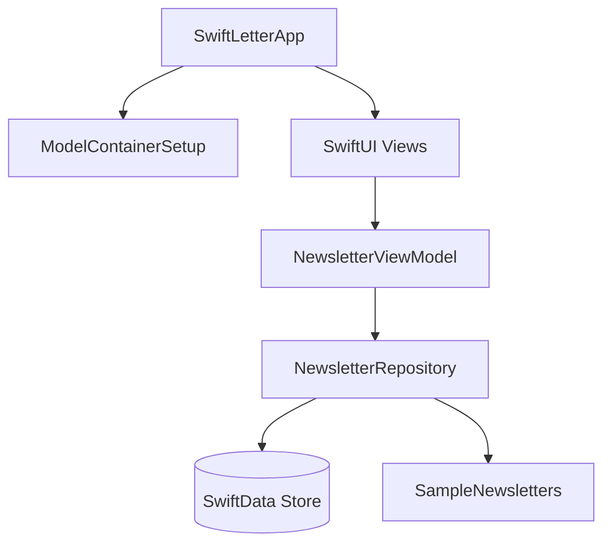
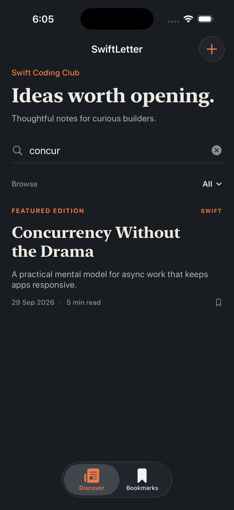
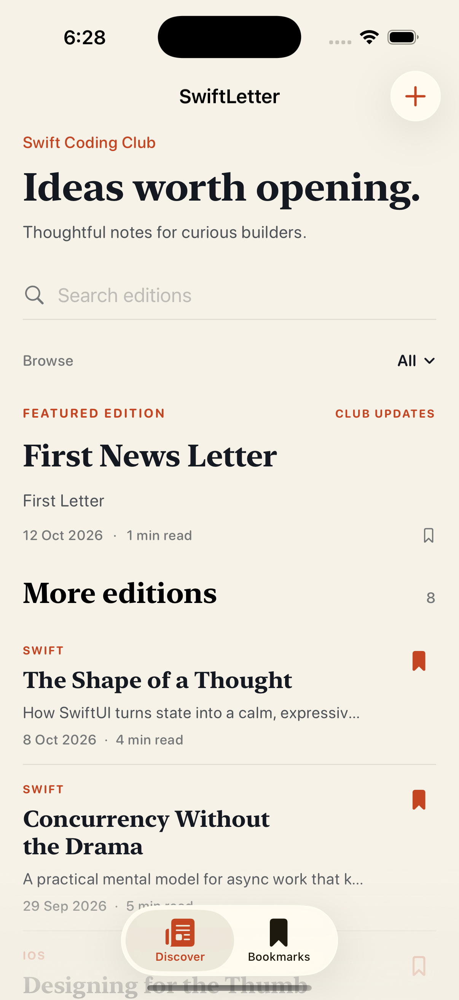
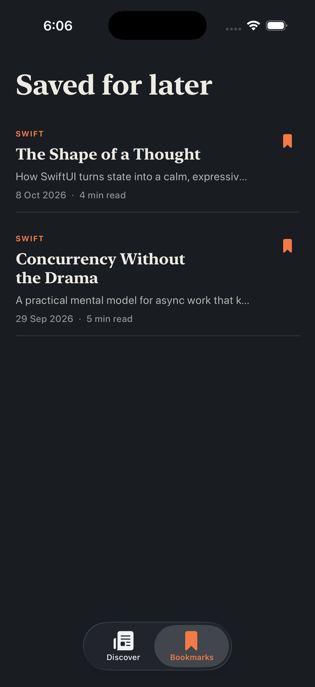
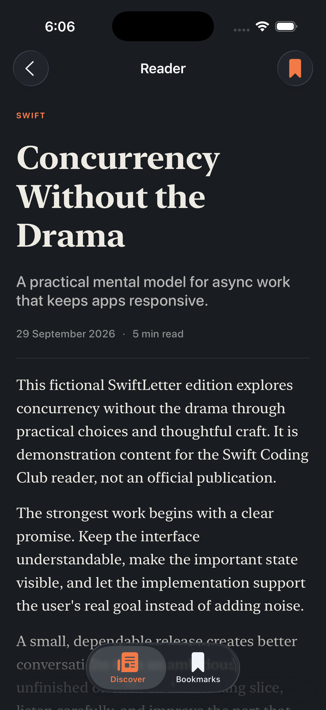
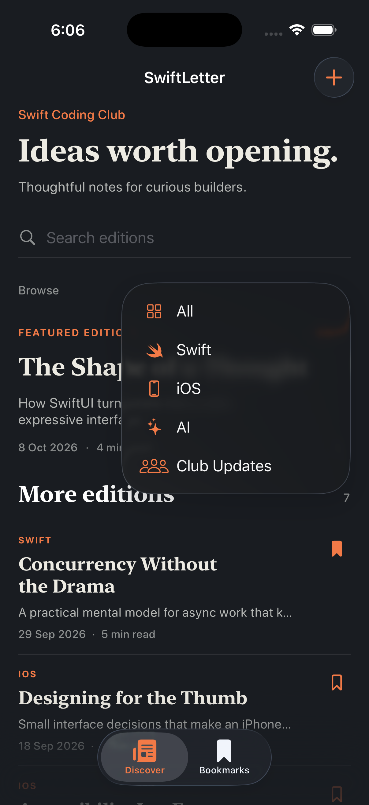
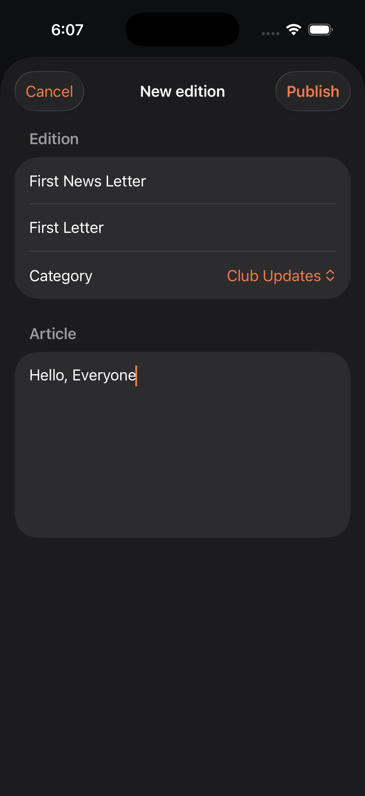
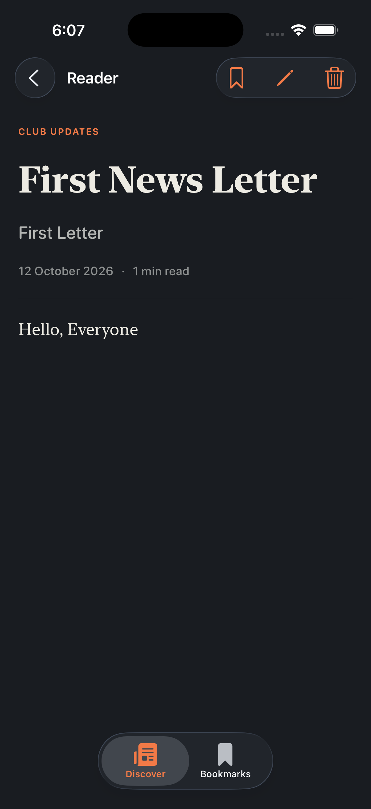
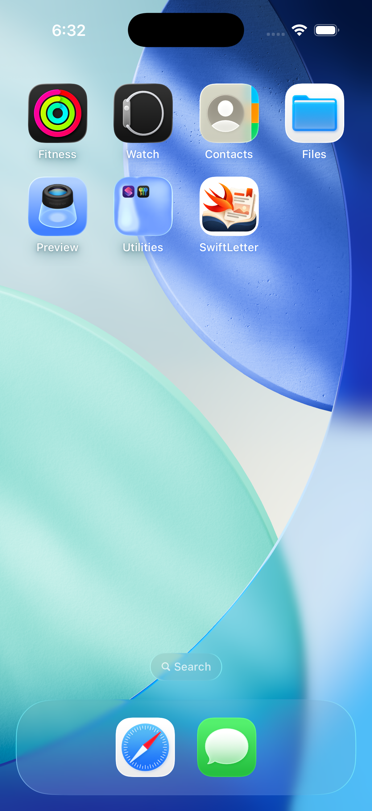

# SwiftLetter

SwiftLetter is a small, offline reading app for the Swift Coding Club at Galgotias University. It is designed to feel more like a quiet magazine than a busy dashboard: open an edition, read it comfortably, and save the pieces worth returning to.

The sample articles are fictional and included to make the app useful from the first launch. Readers can also publish their own local editions, edit them later, and remove them when they are no longer needed.

## Built with

- Swift and SwiftUI
- SwiftData for on-device persistence
- iOS 17 or later
- `NavigationStack`, `TabView`, native controls, and SF Symbols
- Native accessibility support, including labels for icon-only actions
- No accounts, backend, network requests, or third-party packages

## Architecture

The architecture is intentionally small. SwiftUI views describe the screens, while `NewsletterViewModel` handles user intent and derived state such as search results, filters, and bookmarks. The repository is the only layer that writes to SwiftData, which keeps persistence decisions out of the view code.

At launch, the app creates the local model container, seeds the fictional editions once, and injects one view model into the SwiftUI environment. A bookmark or newsletter mutation travels through the view model to the repository, while SwiftData remains the source of truth for the next launch.

## Project structure

- `App/SwiftLetterApp.swift`: model container and dependency setup
- `Models/Newsletter.swift`: SwiftData model and draft validation
- `Models/NewsletterCategory.swift`: type-safe newsletter categories
- `Persistence/ModelContainerSetup.swift`: explicit local store URL and fallback setup
- `Repositories/NewsletterRepository.swift`: persistence operations
- `Resources/SampleNewsletters.swift`: eight fictional seed editions
- `ViewModels/NewsletterViewModel.swift`: observable application state and newsletter actions
- `Views/`: Discover, Bookmarks, reader, reusable rows, filters, forms, and theme

## Run it locally

1. Open `SwiftLetter.xcodeproj` in Xcode 26 or newer.
2. Select an iOS Simulator running iOS 17 or newer.
3. Select the `SwiftLetter` scheme and press Run.

The first launch creates the local SwiftData store and inserts the eight fictional editions once. New editions, edits, deletions, and bookmarks stay on the device after relaunch.

## What you can do

- Browse a featured edition and the rest of the collection
- Search titles, summaries, and full article text
- Combine search with Swift, iOS, AI, or Club Updates filtering
- Read complete articles in a focused reader
- Bookmark editions from the feed or reader
- Publish, edit, and delete user-created editions
- Keep sample content protected from accidental deletion
- Use the app in light or dark appearance

## App icon

The SwiftLetter app icon is included in the asset catalog and uses the supplied Swift-themed artwork. It is normalized to the required 1024x1024 size for the universal iOS AppIcon slot.

## Before submitting

- Launch with an empty database and confirm eight editions appear.
- Relaunch and confirm seed editions are not duplicated.
- Search by title, summary, and article content.
- Combine a search query with each category filter.
- Open an edition and read its complete article body.
- Bookmark and unbookmark from both a row and the reader.
- Relaunch and confirm bookmark state persists.
- Publish a new edition and confirm it appears immediately.
- Edit the created edition and confirm no duplicate is created.
- Delete the created edition and confirm it leaves feeds and bookmarks.
- Confirm empty search results and empty bookmarks are readable.
- Check a compact and a larger iPhone simulator, plus light and dark appearance.

## Screenshots

The screenshots below were captured from the iPhone 17 Pro simulator and show both appearances, the main reading flows, and the finished app icon on-device.

<table>
	<tr>
		<td align="center"><strong>Discover · Dark</strong> </td>
		<td align="center"><strong>Discover · Light</strong> </td>
	</tr>
	<tr>
		<td align="center"><strong>Bookmarks</strong> </td>
		<td align="center"><strong>Reader</strong> </td>
	</tr>
	<tr>
		<td align="center"><strong>Filter menu</strong> </td>
		<td align="center"><strong>Add newsletter</strong> </td>
	</tr>
	<tr>
		<td align="center"><strong>User edition</strong> </td>
		<td align="center"><strong>App icon in iPhone</strong> </td>
	</tr>
</table>

## License

SwiftLetter is open source and available under the [MIT License](LICENSE).

